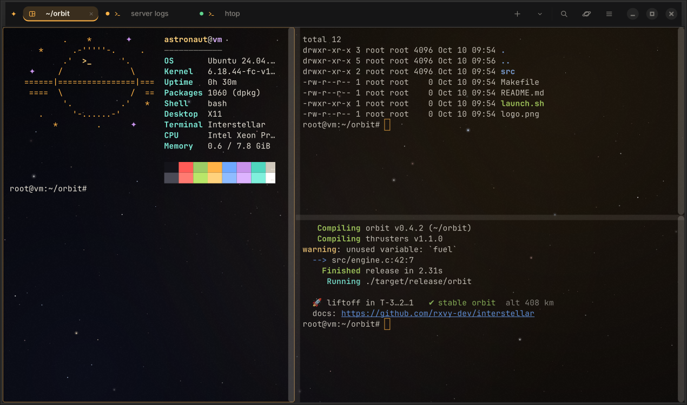
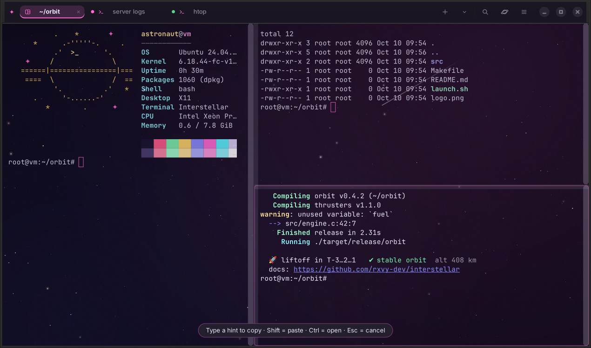
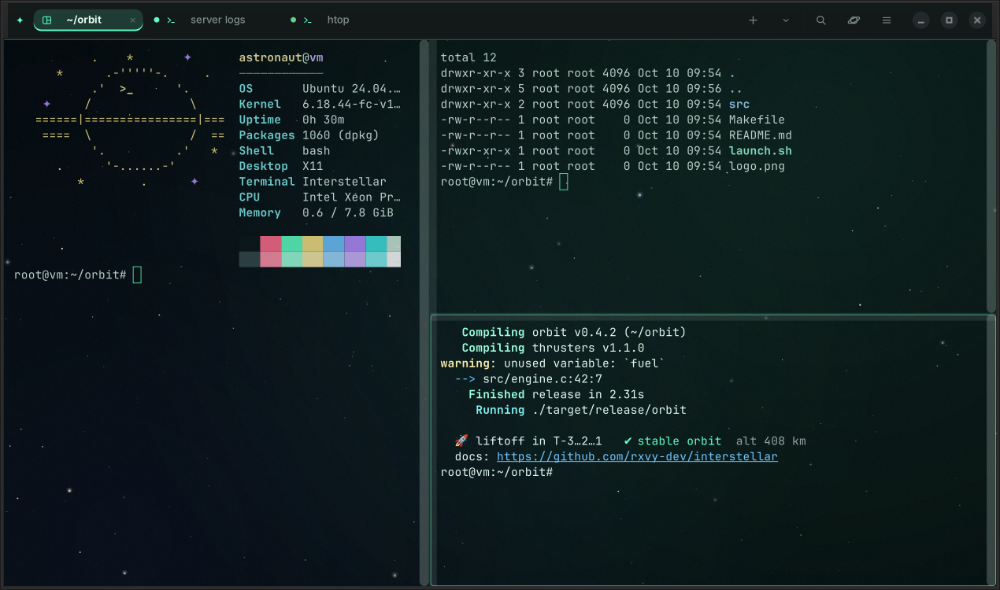
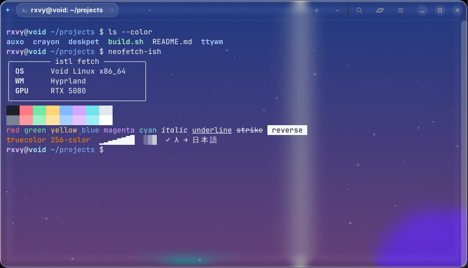
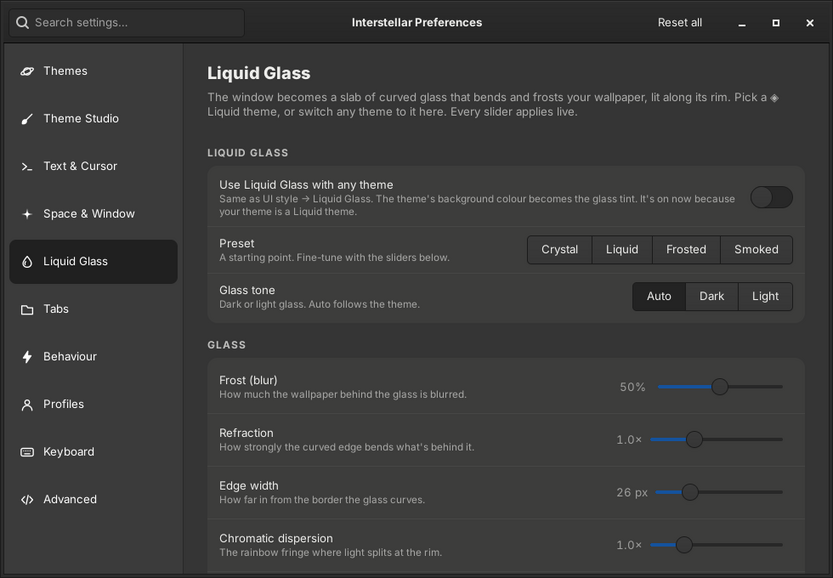
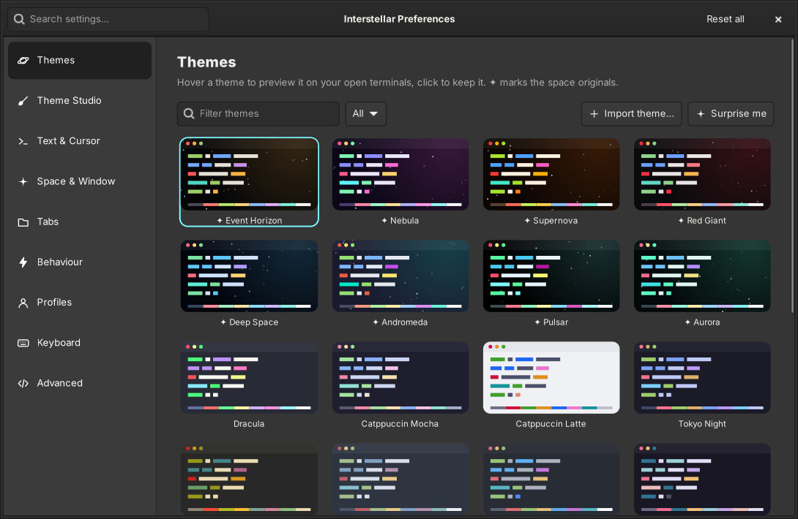
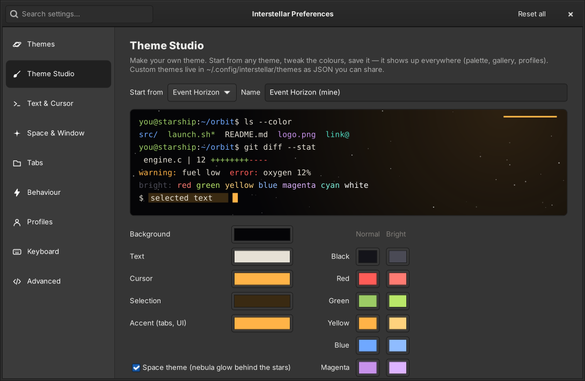
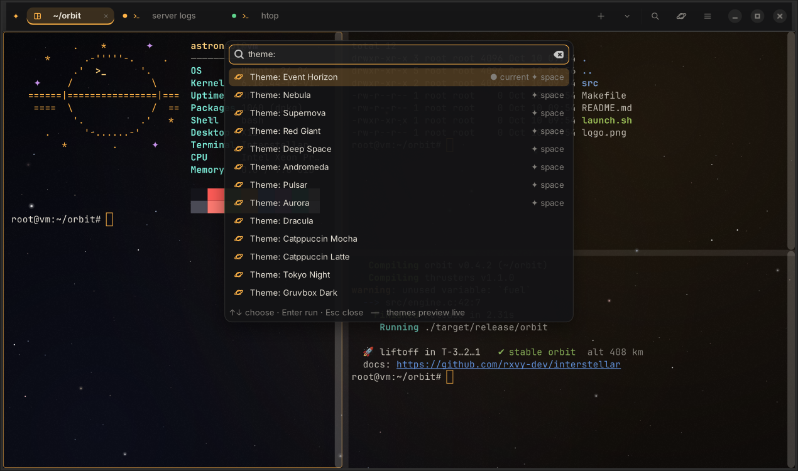
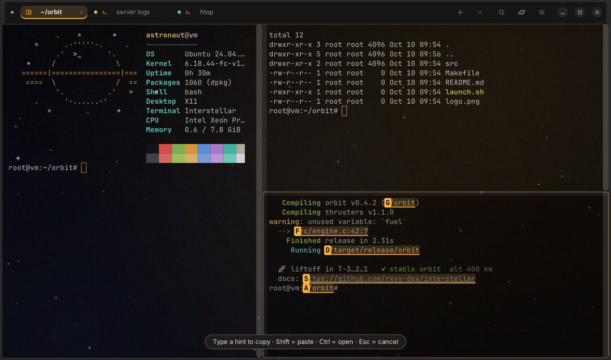

<p align="center">
  
</p>
<h1 align="center">Interstellar Terminal</h1>
<p align="center"><b>A terminal that's out of this world.</b><br>
Tabs, splits, 28 themes, Liquid Glass, an animated starfield, and a settings window for every option.</p>
<p align="center">
  
  
  
  
</p>



Interstellar is written from scratch on GTK 4 and VTE, the same engine GNOME's terminals use, so it's fast and fully compatible: true colour, mouse, OSC 8 hyperlinks, sixel images (when your VTE build has them), bracketed paste and everything `vim`, `tmux` and `htop` expect.

Every option has a switch, slider or picker in **Preferences**, and changes apply to your open terminals as you make them. There's no config file to edit, though there is one if you want it.

## Install: one line, any distro

```bash
curl -fsSL https://raw.githubusercontent.com/rxvy-dev/interstellar/main/get.sh | bash
```

The script downloads Interstellar and installs GTK 4 and VTE with your distro's package manager (it asks once). It then adds Interstellar to your app menu. Start it from there, or type `interstellar` (or the short `istl`).

Update later with `interstellar --update`. Remove it with `interstellar --uninstall`.

<details>
<summary><b>Prefer to clone it yourself?</b></summary>

```bash
git clone https://github.com/rxvy-dev/interstellar.git
cd interstellar
./install.sh
```
</details>

| Distro | Package manager | What gets installed |
|---|---|---|
| Void (glibc and musl) | xbps | `gtk4 vte3-gtk4 python3-gobject python3-cairo` |
| Arch, Manjaro, EndeavourOS, CachyOS, Artix, Garuda | pacman | `gtk4 vte4 python-gobject python-cairo` |
| Debian 12+, Ubuntu 23.04+, Mint 22+, Pop!_OS 24+, Kali | apt | `gir1.2-gtk-4.0 gir1.2-vte-3.91 python3-gi python3-gi-cairo` |
| Fedora, RHEL / Alma / Rocky 9+ | dnf | `gtk4 vte291-gtk4 python3-gobject python3-cairo` |
| openSUSE Tumbleweed, Leap 15.6+ | zypper | `typelib-1_0-Gtk-4_0 typelib-1_0-Vte-3_91 python3-gobject` |
| Alpine, postmarketOS | apk | `gtk4.0 vte3-gtk4 py3-gobject3 py3-cairo` |
| Gentoo | emerge | `gui-libs/gtk x11-libs/vte` (the installer tells you the USE flags) |
| NixOS | — | `nix-shell --run ./bin/interstellar` (uses `shell.nix`) |
| Fedora Silverblue / Kinoite | rpm-ostree | layered packages (or run it in a toolbox) |

The installer also tries to add a nice font (JetBrains Mono or Fira Code) and the helpers for the drop-down terminal. These are optional, and nothing breaks if one isn't packaged on your distro.

Installer options (they work after `get.sh | bash -s --` too):

```bash
./install.sh -y              # no questions
./install.sh --user          # install to ~/.local (no sudo for Interstellar itself)
./install.sh --default       # also make it your default terminal
./install.sh --minimal       # only what's needed to start
./install.sh --no-deps       # don't touch the package manager
./install.sh --print-deps    # show the package command for your distro without running it
./install.sh --check         # what's installed / missing  (same as: interstellar --doctor)
./install.sh --uninstall     # remove it
```

If you don't want to install it, run it from the folder with `./bin/interstellar`.

**Requirements:** Python 3.9+, PyGObject with its cairo bridge, GTK 4.10+, and VTE for GTK 4 (`Vte-3.91` typelib).

## What makes it different

### Space, but useful
- **Animated starfield:** parallax stars drift behind your text, with the odd shooting star. It's drawn once behind the whole window, so it flows across split panes. You can set it to Drift, Twinkle or Still (Still uses no CPU), and choose the density. Toggle it with `Ctrl+Shift+F11`.
- **Space themes:** Event Horizon (the default), Nebula, Supernova, Red Giant, Deep Space, Andromeda, Pulsar and Aurora, plus the classics: Dracula, Catppuccin, Tokyo Night, Gruvbox, Nord, One Dark, Rosé Pine, Kanagawa, Everforest, Solarized, Monokai, GitHub, Matrix and Amber CRT.
- **Background images** with adjustable dimming, **window transparency**, and four window styles: Glass, Solid, Minimal and [Liquid Glass](#liquid-glass).
- **`istl fetch`** prints a space-themed system summary, so your screenshots look good too.

| Nebula | Aurora |
|---|---|
|  |  |

### Liquid Glass


The whole window becomes a slab of curved glass over your wallpaper. The edge bends and splits the light like real glass, the middle frosts it, and a highlight runs along the rim. The starfield keeps drifting inside it.

- **Themes:** pick **◈ Liquid Glass**, **◈ Liquid Glass Light** or **◈ Liquid Nebula** in the gallery, or set *UI style → Liquid Glass* to turn any theme into glass (its background colour becomes the tint).
- **Settings for everything** in *Preferences → Liquid Glass*: frost (blur), refraction, edge width, chromatic dispersion, lens, tint, vibrancy, rim light, grain, corner radius, shadow, glass tone and stars on the glass. Presets (*Crystal*, *Liquid*, *Frosted*, *Smoked*) give you a starting point, and every slider applies live.
- **Your real wallpaper:** it's found automatically from swww, awww, hyprpaper, waypaper or swaybg, or you can choose a picture. With none, the glass refracts a soft aurora in the theme's colours.
- **On Hyprland** the glass follows the window, so it bends the part of the wallpaper that's really behind it, even while you drag it. Elsewhere it refracts the wallpaper as if the window sat in the top-left corner.
- It's drawn with OpenGL and only re-renders when the window moves, resizes or a setting changes, so typing costs nothing extra. If OpenGL isn't available, a frosted-glass fallback is used (no refraction).

The glass shows your wallpaper, not the windows behind it (like macOS). On Hyprland, set *Corner radius* to your `decoration:rounding` so the corners line up.



### Customize everything, with a GUI
| Theme gallery: hover to preview, click to keep | Theme Studio |
|---|---|
|  |  |

- **Theme gallery:** hover over a theme to preview it on your real terminals, and click to keep it. You can filter by Space / Dark / Light / Custom, or click *Surprise me*.
- **Theme Studio:** start from any theme and change any of its 21 colours with a live preview. Save it, export it as JSON to share, and swap light/dark in one click.
- **Import** themes from **kitty**, **Alacritty** (TOML or YAML) and **base16**. Use Preferences, or run `interstellar --import-theme file`.
- **Fonts:** pick from a list of your installed monospace fonts, and set the size, line height and letter spacing. If a font is missing, Interstellar picks another one automatically.
- **Cursor:** block, beam or underline, blinking or not, in any colour.
- **Window:** padding, opacity, tab bar on top or bottom, and hide the tab bar when there's only one tab.
- **Profiles:** give a shell or program its own folder, theme, font and environment variables. For example, a *Prod* profile with a red theme, or a *Python* profile that opens `python3`. Open one from the ▾ next to +.
- **Keyboard:** rebind any shortcut by clicking it and pressing the new keys. If the keys are already used elsewhere, Interstellar tells you and removes the old binding.
- **Custom CSS** if you want to restyle the window chrome itself.
- **Search** across all settings, plus import / export / reset.

### Tabs and splits that just work
- **Split** right `Ctrl+Shift+D` or down `Ctrl+Shift+E`, as deep as you like. Move between panes with `Alt+←↑→↓`.
- **Zoom** a pane to full size with `Ctrl+Shift+Z`. Press it again to show all panes.
- **Broadcast input** (`Ctrl+Shift+I`) types into every pane of a tab at once. It's handy for running the same command on several servers.
- **Tabs:** drag to reorder, double-click to rename, middle-click to close. Right-click a tab to duplicate it, move it to a new window or close the others. Scroll on the tab bar to switch tabs, or use `Alt+1…9`.
- **Session restore:** every tab, split layout, folder and tab name comes back when you reopen Interstellar.
- **New tabs open in the folder you're in.**
- **Tab icons and dots:** a ▶ icon means a program is running, a coloured dot means a background tab has new output, and a green dot means a long command finished.

### Opens instantly
Interstellar keeps running in the background after you close the last window, so the next one opens straight away: the launcher asks the running copy for a window over D-Bus instead of starting Python and GTK again. Start it at login with `interstellar --daemon` and even the first window is instant. You can switch this off in *Preferences → Behaviour*, and *Menu → Quit* always quits.

```lua
-- Hyprland (Lua config)
hl.on("hyprland.start", function() hl.exec_cmd("interstellar --daemon") end)
```
```ini
# Hyprland (hyprland.conf)
exec-once = interstellar --daemon
```

### Small things that save time


- **Command palette** (`Ctrl+Shift+P`): every action, theme (with live preview), profile, tab and setting, in one fuzzy search box. Type `theme:` to list only themes.
- **Quick select** (`Ctrl+Shift+Space`): every URL, path, `file:line`, git hash, IP address, UUID and e-mail on screen gets a letter. Type the letter to copy it, hold Shift to paste it, or hold Ctrl to open it. You don't need the mouse.

  
- **Clickable links:** URLs, OSC 8 hyperlinks, paths and compiler errors like `src/main.c:42:7`. `Ctrl+Click` opens them (you can switch this to a plain click). Files open at the right line in `$EDITOR`, or in an editor command you choose (`code -g {file}:{line}`).
- **Safe paste:** Interstellar asks before pasting several lines, or anything containing `sudo`, `rm -rf`, `mkfs` or `curl … | sh`. It shows a preview and has a *Paste as one line* option.
- **Notifications:** when a command that ran for 8+ seconds finishes in a tab you aren't looking at, you get a desktop notification. Click it to jump to that tab.
- **Search the scrollback** (`Ctrl+Shift+F`) with match case, regex and a match count.
- **Jump between prompts** with `Ctrl+Shift+↑/↓`.
- **Save the output** to a file with `Ctrl+Shift+S`.
- **Drag files in** to paste their quoted paths.
- **Copy on select**, a visual bell, and per-pane zoom (`Ctrl+` / `Ctrl−`).
- **Drop-down (quake) terminal:** bind `interstellar --quake` to a key (F12 works well) in your desktop's keyboard settings. It slides down from the top of the screen and hides again. On Wayland it uses `gtk4-layer-shell` when that's installed; on X11 it uses `xdotool`/`wmctrl`.

## Keys

| | |
|---|---|
| New tab / window | `Ctrl+Shift+T` / `Ctrl+Shift+N` |
| Close pane | `Ctrl+Shift+W` |
| Split right / down | `Ctrl+Shift+D` / `Ctrl+Shift+E` |
| Move between panes | `Alt+←↑→↓` |
| Zoom pane | `Ctrl+Shift+Z` |
| Next / previous tab, tab N | `Ctrl+PgDn` / `Ctrl+PgUp`, `Alt+1…9` |
| Move tab | `Ctrl+Shift+PgUp` / `Ctrl+Shift+PgDn` |
| Rename tab | `Ctrl+Shift+R` (or double-click it) |
| Copy / paste | `Ctrl+Shift+C` / `Ctrl+Shift+V` |
| Find | `Ctrl+Shift+F` |
| Command palette | `Ctrl+Shift+P` |
| Quick select | `Ctrl+Shift+Space` |
| Broadcast to panes | `Ctrl+Shift+I` |
| Text size | `Ctrl+` / `Ctrl−` / `Ctrl+0` |
| Previous / next prompt | `Ctrl+Shift+↑` / `Ctrl+Shift+↓` |
| Clear scrollback | `Ctrl+Shift+K` |
| Save output | `Ctrl+Shift+S` |
| Open folder | `Ctrl+Shift+O` |
| Next theme / toggle starfield | `Ctrl+Shift+F12` / `Ctrl+Shift+F11` |
| Preferences / fullscreen | `Ctrl+,` / `F11` |

You can change any of these in Preferences → Keyboard.

## Command line

```bash
interstellar                         # opens a window and restores your last session
interstellar -e htop                 # run a program instead of the shell
interstellar -d ~/code --tab         # open a tab in the window that's already running
interstellar -p Python               # use a profile
interstellar --theme "Deep Space"    # switch theme (and keep it)
interstellar --list-themes
interstellar --import-theme ~/Downloads/gruvbox.toml
interstellar --quake                 # toggle the drop-down terminal
interstellar --daemon                # start in the background at login: every window opens instantly
interstellar --fetch                 # (or: istl fetch) space-themed system info
interstellar --doctor                # check dependencies
interstellar --update | --uninstall | --version | --help
```

It works as the default terminal for file managers and `xdg-terminal-exec`. Run `./install.sh --default` to set that up.

## Files

- `~/.config/interstellar/settings.json`: every setting (Preferences writes it, but you can edit it too)
- `~/.config/interstellar/themes/*.json`: your themes, in this format:
  ```json
  { "name": "My Theme", "fg": "#e6e1d6", "bg": "#050507", "cursor": "#ffb347",
    "selection": "#3a2a12", "accent": "#ffb347", "space": true,
    "palette": ["#14141a", "#ff5c57", "…16 colours: 8 normal then 8 bright…"] }
  ```

## Packages

| | Command |
|---|---|
| Debian / Ubuntu `.deb` | `make deb` → `dist/interstellar_1.0.0_all.deb` |
| Fedora / openSUSE `.rpm` | `make rpm` (uses `packaging/rpm/interstellar.spec`) |
| Arch | `make dist && cp dist/*.tar.gz packaging/ && cd packaging && makepkg -si` |
| Void | copy `packaging/void/template` to `void-packages/srcpkgs/interstellar/` and run `./xbps-src pkg interstellar` |
| Alpine | `packaging/alpine/APKBUILD` |
| Source tarball | `make dist` |

## Publishing your own copy

```bash
./publish.sh                    # creates github.com/<you>/interstellar, pushes, makes a v1.0.0 release (.deb + tarball)
./publish.sh --name myterm      # different repo name   ·   --private   ·   --no-release
```

The script installs and logs in to the GitHub CLI (`gh`) if needed. It also points every link (README, `get.sh`, packages, `interstellar --update`) at your repo.

## Development

```bash
./bin/interstellar --no-restore   # run from the source tree
make test                         # unit tests (themes, importers, settings, keys, palette, quick select)
make check                        # dependency doctor
python3 tools/make_icon.py        # re-render the app icon
```

Code map:

| File | What it does |
|---|---|
| `interstellar/app.py` | Application, command line, CSS, session and quake window |
| `window.py` | Tab bar, tabs, split tree and actions |
| `pane.py` | One terminal: VTE, links, search, paste and process tracking |
| `starfield.py` | The backdrop |
| `prefs.py` | Preferences |
| `palette.py` | Command palette |
| `quickselect.py` | Quick select hints |
| `themes.py` | Themes and importers |
| `chrome.py` | Window CSS |
| `icons.py` | Cairo-drawn icons |
| `fetch.py` | `istl fetch` |

## License
MIT

The Liquid Glass refraction shader (`interstellar/liquid.py`) is adapted from MacShell's Liquid Glass by Rickky, also MIT licensed.
